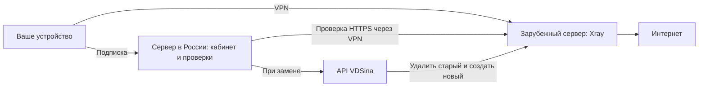

# ASMove VPN

[](https://github.com/almuleev/asmove-vpn/actions/workflows/tests.yml)

**Свой VPN перестал работать? Замените сервер, сохранив подписки пользователей.**

[English](README.en.md) · [Начать установку](docs/QUICKSTART.md) · [Как работает автозамена](docs/AUTOMATION.md) · [Помощь](https://github.com/almuleev/asmove-vpn/discussions)

ASMove VPN — программа для управления своим VPN на двух арендованных серверах.
Российский сервер хранит кабинет, пользователей и проверяет связь. Зарубежный
сервер обеспечивает VPN. Если связь устойчиво пропала, ASMove VPN может заменить
зарубежный сервер через API VDSina и восстановить подключения.

**Главная польза:** вам не нужно рассылать новые ссылки всем пользователям.
Адрес подписки остаётся тем же; в приложении нужно обновить подписку и подключиться заново.

**Статус: preview.** Локальные тесты есть; установка этой версии на чистых VPS,
реальная автозамена и приложения на устройствах пока не проверены. Обычная смена
сервера не гарантирует обход любых ограничений сети.

## Кому это пригодится

У вас свой VPN для себя, семьи или небольшой группы. Вы хотите видеть, работает
ли он из российской сети, и восстанавливать его без ручного переноса пользователей.
Для одного простого VPN без мониторинга два VPS могут быть лишними.

## Что умеет

- Проверяет открытие HTTPS-сайтов **через VPN**, а не только доступность порта.
- Даёт кабинет, постоянные подписки, сроки доступа и отзыв пользователей.
- Меняет EU вручную после подтверждения или автоматически по вашим правилам.
- Восстанавливает UUID, коды, сроки и настройки пользователей из проверенного архива.
- Проверяет VPN перед публикацией новых настроек.
- Не повторяет заказ вслепую, если ответ API потерялся.
- При желании отправляет уведомления Telegram/ntfy.

## Как устроено



**RU** — российский управляющий сервер. **EU** — зарубежный VPN-сервер.
**API** — способ, которым программа управляет вашим VPS у провайдера.
**Подписка** — постоянная ссылка, по которой VPN-приложение получает свежие настройки.

## Начать: подключить серверы и API

1. Арендуйте RU и первый EU с чистой Ubuntu 24.04 LTS amd64 и публичными IPv4.
2. EU должен быть на фиксированном тарифе **VDSina.com USD 0.07/сутки**.
3. Подключитесь к RU по SSH, скачайте проект и запустите мастер:

```bash
sudo apt-get update
sudo apt-get install -y git python3 ca-certificates
git clone https://github.com/almuleev/asmove-vpn.git /opt/asmove-src
cd /opt/asmove-src
sudo python3 deploy/setup.py
```

Мастер объяснит, куда добавить публичный SSH-ключ, попросит IP EU, проверенный
SSH-отпечаток и API-токен. ID тарифа, площадки, ОС и ключа получит из API.
Он установит компоненты и проверит VPN. Первый EU вы создаёте сами; мастер
не арендует VPS. Не запускайте его поверх работающей установки.

**[Полный путь для новичка: где нажать и что ввести](docs/QUICKSTART.md)**.
[Подробная ручная установка](docs/INSTALL.md) остаётся для опытных пользователей.
Уведомления и дополнительные функции можно настроить позже.

## Автоматическое восстановление

Автоматика включается один раз владельцем в мастере или в админке → Серверы и замены.
Ручной режим доступен всегда. В правилах можно выбрать:

| Настройка | Начальное значение |
| --- | --- |
| Что считать отказом | Не проходят HTTPS-запросы через VPN к двум разным целям |
| Дополнительное условие | При желании требовать ещё и недоступность TCP-порта |
| Сколько неудач подряд | 3 |
| Минимальная длительность | 180 секунд |
| Пауза между автозаменами | 1 час |
| Предел автоматических запусков | 2 за скользящие 24 часа |

Сбой самого наблюдателя или одной проверочной страницы не запускает замену.
Перед удалением заново проверяются условия, архив, личность VPS, тариф и API.
При неизвестном результате заказа, ошибке архива или достижении предела программа
останавливает новые операции и показывает состояние в админке. Ручные замены
не ограничены суточным пределом автоматики.

**При замене сначала удаляется старый VPS. Будет простой.** Если после удаления
провайдер не даёт новый сервер, VPN останется недоступным до восстановления.
[Правила, остановка и ограничения автоматики](docs/AUTOMATION.md).

## Сколько стоит

Вы оплачиваете RU VPS + EU VPS + внешние резервные копии и возможные комиссии/трафик.
[Официальная страница VDSina](https://www.vdsina.com/pricing/standard), проверено
24.11.2026: совместимый EU — $0.07/сутки, то есть $2.10 за 30 дней или $2.17 за 31.
Это **не полная стоимость системы**: RU и хранилище оплачиваются отдельно.
Цена, доступность и минимальный баланс вашего аккаунта проверяются перед заменой.
Похожий тариф дороже $0.07 текущая версия не подставляет.

Для RU рекомендуем стартовый запас 2 vCPU / 2 ГБ RAM / 20 ГБ диска; это рекомендация,
не нагрузочный тест. Домен необязателен: используются HTTPS-сертификаты на IP.
[Подробности расходов и прав API](docs/PROVIDER.md).

## Что важно понимать

- Проверка из одного RU VPS не доказывает работу во всех домашних/мобильных сетях.
- Причина отказа может быть в конфигурации, сертификате, сети или провайдере. Это не обязательно блокировка IP.
- Стабильный URL подписки требует неизменных RU-адреса и ключа приложения. Прямой URI со старым IP придётся импортировать заново.
- Программа получает root SSH и API-токен с большими правами. Изучите [модель доверия и отзыв секретов](docs/OPERATIONS.md).
- Свежий проверенный архив обязателен. Долгая полная недоступность EU может сделать безопасную замену невозможной без ручного восстановления.
- Relay по умолчанию отключён; публичного доступа всем пользователям нет.

## Нужна помощь или хотите участвовать?

**Есть вопрос? Напишите мне — я автор ASMove VPN и обязательно отвечу.**
Можно обращаться с вопросами об установке, настройке, работе проекта и идеями
по улучшению. Не обязательно разбираться в Linux или заранее знать причину ошибки.

**[Написать автору на GitHub](https://github.com/almuleev/asmove-vpn/discussions/new)** —
выберите подходящую категорию, опишите вопрос своими словами и нажмите Start discussion.
Переписка публичная: пароли, токены, VPN-ссылки и базы прикладывать не нужно.

[Вопросы и опыт установки](https://github.com/almuleev/asmove-vpn/discussions) ·
[Сообщить об ошибке](https://github.com/almuleev/asmove-vpn/issues/new/choose) ·
[Предложить улучшение](https://github.com/almuleev/asmove-vpn/issues/new/choose) ·
[Правила участия](CONTRIBUTING.md) · [Уязвимости](SECURITY.md)

Если ASMove VPN оказался полезен, поставьте ⭐ — это простой способ поддержать проект.
Особенно полезны отчёты о чистой установке: ОС, версия, на каком шаге возникла трудность,
результат проверки. Секреты, VPN-ссылки и базы в публичные обсуждения не прикладывайте.

## Документация и разработка

[Диагностика](docs/DIAGNOSTICS.md) · [Backup и восстановление](docs/OPERATIONS.md) ·
[План развития](docs/ROADMAP.md) · [Что проверено](docs/VALIDATION.md) ·
[Источники и исследование](docs/RESEARCH.md) · [Происхождение кода](docs/AUDIT.md)

```bash
python3 -m venv .venv
. .venv/bin/activate
python -m pip install -r requirements-dev.txt -c requirements-constraints.txt
python -m unittest discover -s tests
node --test launcher/test.mjs
python tools/build_site.py
python tools/check_public.py
```

Целевая среда: Ubuntu 24.04, Python 3.12, systemd. Node 22+ нужен только для тестов.
[MIT](LICENSE); [сторонние лицензии](NOTICE.md). Заказов/удалений VPS в тестах нет.
