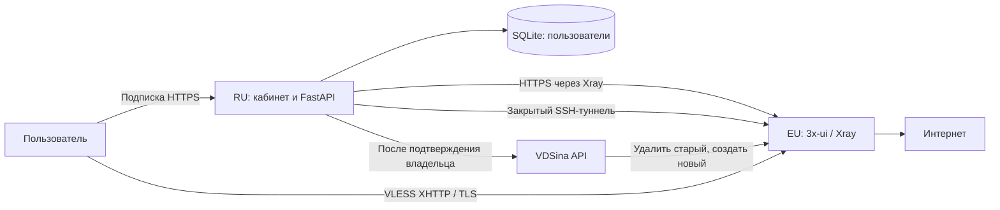

# VPN Node Guard

**Обнаружить сбой своего VPN. Подтвердить замену сервера. Сохранить подписки пользователей.**

Система для владельца собственного VPN: российский VPS проверяет зарубежный узел
реальным HTTPS-запросом через Xray и помогает заменить его через VDSina.
Кабинет и URL подписок остаются на RU; после восстановления пользователи обновляют
подписку и переподключаются.

**Статус: локальная предварительная версия.** Перенесённый код проверяется тестами;
первичная установка этого проекта на чистых VPS ещё не проверена. Не гарантирует
обход любых ограничений и не определяет причину каждого сбоя автоматически.

**[Начать пошаговую установку](docs/INSTALL.md)** ·
[Диагностика](docs/DIAGNOSTICS.md) · [Восстановление](docs/OPERATIONS.md) ·
[Исследование и источники](docs/RESEARCH.md) · [Что проверено](docs/VALIDATION.md)

## Кому подходит

Владельцу небольшого собственного VPN, готовому оплачивать два VPS, хранить
резервные копии и подтверждать замены. Опыт Linux не обязателен для чтения
инструкции, но при ошибке понадобится открыть SSH-консоль и посмотреть состояние.
Если нужен только один VPN без собственного управления и мониторинга, два сервера
и ключ провайдера могут оказаться излишней сложностью.

## Как это работает



Встроенный кабинет доступен прямо на RU. Отдельный статический кабинет можно
разместить на собственном GitHub Pages origin. Рекламная страница проекта
собирается отдельно из `site/` и не содержит кабинет или доступ к API.

## Возможности первой версии

| Возможность | Граница |
| --- | --- |
| Вход по коду, сроки, отзыв доступа, админка с CSRF | Основная база только на RU |
| Постоянная подписка, основной XHTTP/TLS и дополнительный TCP/REALITY | Поддержка клиента зависит от его Xray; TLS проверяется |
| Реальный HTTPS через VPN и контроль доступности наблюдателя | Одна RU-точка не представляет все российские сети |
| Предложение замены после последовательных неудач | Сбой не объявляется доказанной блокировкой IP |
| Проверенный архив, удаление старого VPS, заказ и восстановление | Только после подтверждения точного IP и простоя |
| Сохранение UUID, кодов, сроков и подписей подписок | Нужны неизменный RU origin и исходный SITE_ACCESS_KEY |
| Telegram и независимая очередь ntfy | Необязательны; задержка уведомлений не блокирует админку |
| Защита от повторного заказа после timeout | Неизвестный результат требует сверки текущей заявки |

При замене **сначала удаляется старый VPS**. Затем создаётся и проверяется новый.
Перерыв ожидаем; его длительность зависит от API, установки, сертификата и сети.
Верхняя граница не гарантирована. При отказе после удаления связь отсутствует до
успешного восстановления. Обычная прямая ссылка содержит прежний IP — импортируйте
новую. Подписку обновите вручную, если приложение ещё не сделало это само.

## Что потребуется и сколько стоит

Два разных публичных IPv4, root SSH, **Ubuntu 24.04 LTS amd64 + systemd**.
Для RU рекомендуем как стартовый запас 2 vCPU, 2 ГБ RAM, 20 ГБ диска; это инженерная
рекомендация, не результат нагрузочного теста. EU — совместимый фиксированный
тариф VDSina.com **ровно $0.07/сутки**. Первый EU вы создаёте вручную.

Проверено 24.11.2026: [VDSina Standard](https://www.vdsina.com/pricing/standard)
показывает $0.07/сутки (1 vCPU, 1 ГБ RAM, 10 ГБ диска, 1 ТБ трафика).
Это $2.10 за 30 дней или $2.17 за 31 день; доступность и minimum balance зависят
от аккаунта. Более дорогой похожий тариф несовместим с текущей политикой.

Бюджет = **ваш RU VPS + $2.10–2.17 за EU + внешние резервные копии + возможный
перерасход трафика/комиссии/налоги**. Например, [Timeweb Cloud](https://timeweb.cloud/services/vds-vps)
позволяет выбрать RU, но цену нужной конфигурации нужно посмотреть в калькуляторе:
проверенной фиксированной цены RU здесь нет. Домен необязателен. Платёжный модуль
и месячный бюджет в кабинете отсутствуют. Подробности — [расходы и API](docs/PROVIDER.md).

## Доверие и ограничения

Установщик получает root на двух серверах, а исполнитель — API-токен с возможностью
удалять и заказывать VPS. Скрипты доступны для чтения; команды не отправляют эти
данные авторам. API, загрузки пакетов и центр сертификации получают обычные запросы.
Первый SSH host key проверяется по консоли провайдера; для заказанных замен
используется TOFU с отдельным alias service ID — это остаточный риск первого контакта.

Полностью автономной замены без подтверждения нет. До её реализации понадобятся
независимые наблюдатели, несколько целей проверки, подавление дребезга, остановка
при неопределённом заказе и явно заданная владельцем политика расходов.
Relay не включён для всех: нужен отдельный whitelist аккаунтов и IP.
Старые облачные переключатели, реплики кабинета и аварийные установщики не являются
поддерживаемыми сценариями этой версии. Внутренние модули совместимости описаны
в [аудите переноса](docs/AUDIT.md).

## Разработка и участие

```bash
python3 -m venv .venv
. .venv/bin/activate
python -m pip install -r requirements-dev.txt -c requirements-constraints.txt
python -m unittest discover -s tests
node --test launcher/test.mjs
python tools/build_site.py
python tools/check_public.py
```

Python 3.12 — целевая версия на Ubuntu; Node.js 22+ нужен только для тестов.
Не запускайте bootstrap на установленном сервере ради проверки.
[Сообщить об ошибке](CONTRIBUTING.md#сообщить-об-ошибке) ·
[Внести изменение](CONTRIBUTING.md) · [Сообщить об уязвимости](SECURITY.md).
Если проект помог, поставьте звезду после его публикации на GitHub.

[MIT](LICENSE). Сторонние компоненты сохраняют собственные лицензии:
[NOTICE](NOTICE.md). Публикация репозитория и Pages пока не выполнялась;
[порядок публикации](docs/PUBLISHING.md).
